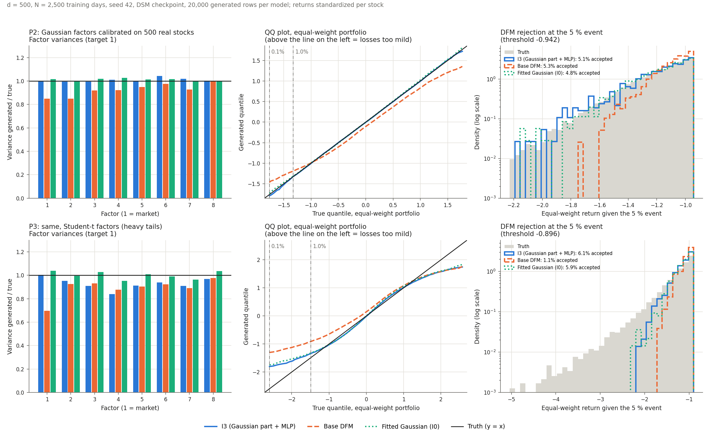

# 9. Améliorer le DFM à d = 500 : cinq variantes, trois populations

**Statut : ✓ une amélioration nette (I3), mais une limite claire sur les queues épaisses.**
- La partie gaussienne explicite dans g (I3) ramène le DFM au niveau de la référence
  gaussienne ajustée à d = 500. C'est vrai sur les deux populations gaussiennes, avec
  2 500 comme avec 12 000 observations, y compris pour le rejet conditionnel à 5 %.
- Quand les facteurs ont des queues épaisses, aucune variante ne reproduit les queues :
  les pertes extrêmes restent 2 à 5 fois trop rares.

Le plan suivi est [plan_dfm_grande_dimension.md](plan_dfm_grande_dimension.md). Le
code est dans [dfm_variants.py](../dfm_variants.py) et
[scripts/dfm_upgrades.py](../scripts/dfm_upgrades.py), avec des tests dans
`tests/test_dfm_variants.py`.

## Ce qui a été codé

Toutes les variantes gardent la forme du score de Chen et al. (2025) :
s = α_t D_t V g(Vᵀ D_t r, t) − D_t r. Le guidage par coordonnées réduites reste donc
utilisable. Aucun module existant n'a été modifié.

- **I0, la référence gaussienne ajustée.** C'est un modèle gaussien « facteurs +
  diagonale » ajusté directement sur les données d'entraînement, sans réseau ni
  checkpoint. On en tire des échantillons de deux façons :
  - directement ;
  - avec notre échantillonneur, à partir de son score exact.

  La différence entre les deux mesure l'erreur de l'échantillonneur.
- **I1, un critère pour choisir le checkpoint.** Toutes les 50 epochs, on génère 1 000
  tirages et on compare leurs variances, le long des directions principales, à celles
  de l'échantillon de validation. Chaque DFM garde deux checkpoints : le meilleur selon
  la perte DSM et le meilleur selon I1.
- **I2, le préconditionnement des données.** Avant l'entraînement, on réduit les
  directions des plus gros facteurs. On revient aux coordonnées d'origine (par P⁻¹)
  avant toute sélection et toute évaluation. Deux variantes :
  - « PC1 seulement » ;
  - la règle ρ = 20, qui réduit toutes les directions dont la variance dépasse
    20 fois la variance résiduelle moyenne.
- **I3, une partie gaussienne explicite dans g.** g = espérance a posteriori exacte des
  facteurs pour un modèle gaussien, plus une correction par MLP.
  - La partie gaussienne est initialisée à partir des données d'entraînement et reste
    entraînable.
  - La correction part de zéro.
  - Un test vérifie qu'avec les vrais paramètres, ce réseau donne exactement le score
    de la population.
- **I4, des entrées de g standardisées** par coordonnée et par temps de diffusion.

## Protocole

- **d = 500**, avec N = 2 500 observations (comme les 2 516 jours du panel réel) et
  N = 12 000.
- **Trois populations :**
  - **P1** : la population gaussienne de Chen et al. (2025), avec k = 16 facteurs ;
  - **P2** : une population gaussienne calibrée sur une cohorte de 500 actions du panel
    réel (rendements standardisés, k = 8). Son spectre est un très gros facteur de
    marché (valeur propre 171,6, λ/c ≈ 312), puis des facteurs modestes (17,8 ; 9,2 ;
    7,1…) ;
  - **P3** : P2 avec des facteurs de Student à 5 degrés de liberté, de même covariance.
    Les queues sont épaisses : l'excès de kurtosis du portefeuille équipondéré est
    d'environ 5,5.
- **Budget** : celui du notebook (1 000 epochs, largeur 64, 400 pas d'échantillonnage),
  le même pour toutes les variantes.
- **Graines** :
  - un tri sur une graine (toutes les variantes, P1 et P2) ;
  - puis une confirmation sur 3 graines du DFM actuel, d'I2 ρ = 20, d'I3 et d'I0, sur
    P1, P2 et P3.
- **Évaluation sur des tirages réservés**, jamais utilisés pour choisir un modèle :
  - 3 000 tirages de la vérité ;
  - 1 000 tirages conditionnels exacts pour l'événement à 5 % du portefeuille
    équipondéré ;
  - un niveau Monte Carlo à taille égale (vérité contre vérité indépendante).
- **Rejet conditionnel** : pour chaque modèle, 1 000 lignes acceptées, comparées à la
  vérité conditionnelle.

## Résultats (moyennes sur 3 graines, checkpoint DSM)

« Facteurs » est le rapport entre variance générée et vraie variance, du plus faible au
plus fort ; la cible est 1. « Bruit MC » est le niveau Monte Carlo à taille égale.

### P2 : population calibrée sur le panel, N = 2 500 (le cas le plus proche du réel)

| | DFM actuel | I2 (ρ = 20) | I3 | I0 (tirages directs) | Bruit MC |
| --- | ---: | ---: | ---: | ---: | ---: |
| Variance du facteur de marché | 0,78 | 0,89 | 0,95 | 1,03 | ±0,03 |
| Facteurs (min–max) | 0,78–1,01 | 0,83–1,04 | 0,95–1,05 | 0,97–1,06 | 0,95–1,03 |
| Erreur de covariance | 0,224 | 0,132 | **0,086** | 0,082 | 0,052 |
| Sliced W1 | 0,074 | 0,080 | **0,037** | 0,034 | 0,030 |
| Fréquence de la perte à 1 % (cible 1 %) | 0,1 % | 0,5 % | **1,0 %** | 0,9 % | — |
| Rejet : acceptation (cible 5 %) | 3,7 % | 4,4 % | **4,9 %** | 5,2 % | — |
| Conditionnel : sliced W1 | 0,100 | 0,071 | **0,050** | 0,053 | 0,049 |
| Conditionnel : KS du portefeuille | 0,262 | 0,115 | **0,037** | 0,025 | 0,025 |
| Temps d'entraînement (4 CPU) | 87 s | 91 s | 199 s | quelques s | — |

À N = 12 000, le classement est le même. I3 obtient une erreur de covariance de 0,069,
un sliced W1 conditionnel de 0,045 (bruit 0,049) et un KS conditionnel de 0,036.

### P1 : population de Chen et al. (2025), N = 12 000

| | DFM actuel | I2 (ρ = 20) | I3 | I0 direct | I0 avec l'échantillonneur | Bruit MC |
| --- | ---: | ---: | ---: | ---: | ---: | ---: |
| Facteurs (min–max) | 0,63–0,92 | 0,79–1,00 | 0,96–1,13 | 0,96–1,07 | 0,93–1,09 | 0,96–1,05 |
| Erreur de covariance | 0,335 | 0,199 | **0,098** | 0,096 | 0,094 | 0,079 |
| Sliced W1 | 0,057 | 0,029 | **0,022** | 0,013 | 0,020 | 0,013 |
| Variance résiduelle (cible 1) | 1,37 | 1,34 | 1,33 | 0,97 | 1,29 | — |
| Conditionnel : sliced W1 | 0,067 | 0,046 | **0,030** | 0,021 | — | 0,021 |
| Conditionnel : KS du portefeuille | 0,035 | 0,036 | 0,053 | 0,026 | — | 0,025 |

À N = 2 500, les erreurs de covariance sont de 0,377 (DFM actuel), 0,235 (I2), 0,123
(I3) et 0,119 (I0).

### P3 : facteurs à queues épaisses

| | DFM actuel | I2 (ρ = 20) | I3 | I0 (gaussien) | Bruit MC |
| --- | ---: | ---: | ---: | ---: | ---: |
| Variance du facteur de marché, N = 2 500 | 0,67 | 0,78 | 0,92 | 1,01 | — |
| Fréquence de la perte à 1 %, N = 2 500 | 0,0 % | 0,1 % | 0,3 % | 0,2 % | — |
| Fréquence de la perte à 1 %, N = 12 000 | 0,4 % | 0,5 % | 0,4 % | 0,3 % | — |
| Conditionnel : sliced W1, N = 2 500 | 0,193 | 0,170 | 0,140 | 0,147 | 0,053 |
| Conditionnel : sliced W1, N = 12 000 | 0,143 | 0,133 | 0,129 | 0,139 | 0,053 |
| Conditionnel : KS, N = 12 000 | 0,157 | 0,116 | 0,154 | 0,149 | 0,027 |

L'excès de kurtosis du portefeuille équipondéré généré reste entre 0,1 et 0,5 pour
toutes les variantes, contre environ 5,5 pour la vérité. Ce chiffre est bruité : la
kurtosis d'échantillon est instable avec des queues épaisses.

### Résultats du tri seulement (une graine)

- **I2 « PC1 seulement »** :
  - presque aucun gain sur P1, qui a plusieurs gros facteurs ;
  - un gain sur P2 comparable à la règle ρ = 20, qui n'y réduit que deux directions.
- **I4 (entrées standardisées)** : les variances des facteurs dépassent la cible
  (jusqu'à 1,2 à 1,5), et l'erreur de covariance est moins bonne qu'avec I2. Variante
  abandonnée.

### Figure : I3 face au DFM actuel et à la référence gaussienne

La figure porte sur une seule graine (42), avec N = 2 500, le checkpoint DSM et 20 000
lignes générées par modèle.

- **À gauche, les variances des facteurs.**
  - Sur P2, I3 (bleu) et la référence gaussienne (vert) sont sur la cible pour les 8
    facteurs.
  - Le DFM actuel (orange) manque 8 à 15 % sur les premiers facteurs.
- **Au milieu, le graphe quantile-quantile du portefeuille équipondéré.**
  - Sur P2, I3 suit la diagonale.
  - Le DFM actuel est trop étroit et un peu décalé vers le bas.
  - Sur P3, tous les modèles quittent la diagonale sous le quantile à 1 % : leurs pertes
    extrêmes sont trop douces.
- **À droite, la loi du portefeuille sachant l'événement à 5 %, obtenue par rejet** (en
  échelle log, pour voir la queue).
  - Sur P2, I3 suit la vérité jusqu'à −2,2.
  - Le DFM actuel s'arrête vers −1,75. Sur cette graine, son taux d'acceptation (5,3 %)
    semble correct, mais c'est un hasard : deux erreurs se compensent au seuil, une loi
    trop étroite et une moyenne trop basse (erreur de moyenne 0,128, contre 0,017 pour
    I3).
  - Sur P3, la vérité descend jusqu'à −5, alors qu'I3 et la référence gaussienne
    s'arrêtent vers −2,2.

## Ce qu'on en déduit

1. **I3 est l'amélioration à garder.**
   - Sur P1 et P2, il atteint le niveau de la référence gaussienne ajustée, pour toutes
     les mesures et pour les deux tailles de données.
   - Sur P2, le rejet conditionnel à 5 % est au niveau du bruit.
   - Le DFM actuel, lui, sous-estime d'environ 21 % la variance du facteur de marché.
     L'écart-type du portefeuille équipondéré est donc trop petit de 11 %, et la perte à
     1 % apparaît 2 à 10 fois trop rarement.
2. **Mais sur ces populations, le succès d'I3 est en partie acquis d'avance.** Sa partie
   gaussienne est exactement le bon modèle pour une population gaussienne. Sur P2, son
   meilleur checkpoint arrive d'ailleurs tôt (epoch 50 à 80 au tri) : l'entraînement
   l'éloigne plutôt de son point de départ.
3. **La correction neuronale n'apprend pas encore les queues épaisses.** Sur P3, I3 ne
   fait pas mieux que la référence gaussienne. Le DFM actuel ne fait pas mieux non plus.
   Reproduire les queues est la prochaine limite pour le S&P 500.
4. **I2 (règle ρ = 20) aide, mais moins.** L'erreur de covariance baisse de 40 à 60 %
   par rapport au DFM actuel. Réduire seulement PC1 ne suffit pas quand il y a plusieurs
   gros facteurs.
5. **Le critère I1 ne donne pas de gain régulier.** Il améliore souvent la covariance,
   qu'il vise directement, mais pas toujours les queues ni la loi jointe. Pour I3, les
   deux checkpoints sont équivalents. On le garde comme diagnostic.
6. **Le rapport λ/c ne suffit pas à prédire la difficulté.** P2 a un λ/c plus grand que
   P1 (312 contre environ 200), mais le DFM actuel y retrouve mieux les variances des
   facteurs. L'échelle absolue compte aussi : la variance résiduelle vaut environ 0,55
   sur P2 et 0,05 sur P1, pour un bruit d'Ornstein-Uhlenbeck de variance 1. Le nombre de
   gros facteurs compte également.
7. **L'échantillonneur gonfle la variance résiduelle d'environ 30 % sur P1, mais
   seulement d'environ 1 % sur P2 et P3.** C'est ce que montre l'écart entre I0 direct
   et I0 avec l'échantillonneur : 0,97 contre 1,29 sur P1.
   - En cause : l'arrêt à t0 = 0,005 et le pas d'Euler, face aux très petites variances
     idiosyncratiques de P1.
   - Sur des rendements réels standardisés, cet effet est négligeable.
   - Sur P1, il explique aussi pourquoi I3 a une queue conditionnelle un peu trop large :
     le portefeuille équipondéré y est surtout idiosyncratique.

## Limites

- **Le budget de 1 000 epochs n'a pas été optimisé.** I3 coûte 2,5 à 4 fois plus de
  temps d'entraînement, à cause d'une petite inversion de matrice k × k par ligne. Ce
  coût peut être réduit.
- **Ici, seul le rejet conditionnel a été évalué.** Le guidage par H sur le DFM I3 est
  testé au [rapport 10](10_guidage_i3_d500.md).
- **Une seule dimension (d = 500) et une seule forme de queues épaisses** (Student à 5
  degrés de liberté).
- **Le tri d'I2 « PC1 seulement » et d'I4 repose sur une seule graine.**

## Suite proposée

1. **Adopter I3 comme DFM de base à d ≥ 500**, puis réentraîner H (recette 40k / 50) et
   vérifier le guidage Refined CDG-ML + dernier pas exact à d = 500, sur P2.
2. **Travailler les queues** :
   - vérifier si la perte DSM est aussi peu sensible aux queues qu'aux variances ;
   - tester une correction plus forte dans I3 (largeur, moyenne mobile des poids, plus
     d'epochs) ;
   - modéliser directement une loi des facteurs à queues épaisses.
3. **Confirmer à d = 1 024**, puis passer au panel réel.

## Fichiers

- [results/09_dfm_upgrades/summary_by_variant.csv](results/09_dfm_upgrades/summary_by_variant.csv) :
  moyennes par population, N, variante et checkpoint.
- [results/09_dfm_upgrades/monte_carlo_reference.csv](results/09_dfm_upgrades/monte_carlo_reference.csv) :
  niveaux Monte Carlo.
- [results/09_dfm_upgrades/p2_population_info.json](results/09_dfm_upgrades/p2_population_info.json) :
  la cohorte et le spectre de P2.
- Résultats complets, courbes et checkpoints :
  - en local : `artifacts/dfm_upgrades/{screen1,confirm1,heavy1}/results.json` ;
  - sur le volume Modal `thesis-runs` : `/dfm_upgrades/`, avec les checkpoints
    `dfm_dsm.pt` et `dfm_i1.pt` de chaque run.
- [figures/09_i3_p2_p3.png](figures/09_i3_p2_p3.png) : la figure ci-dessus, produite par
  `scripts/plot_dfm_upgrades.py` à partir des checkpoints téléchargés dans
  `artifacts/dfm_upgrades/checkpoints/`.
