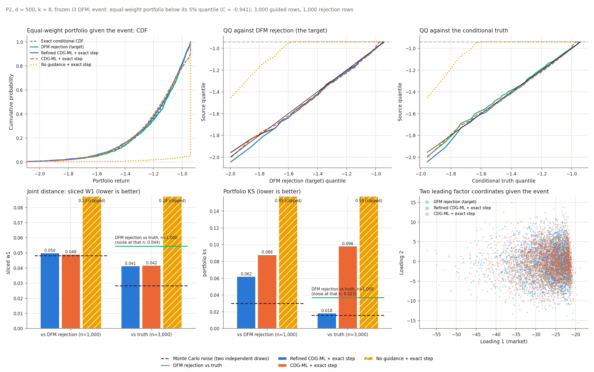
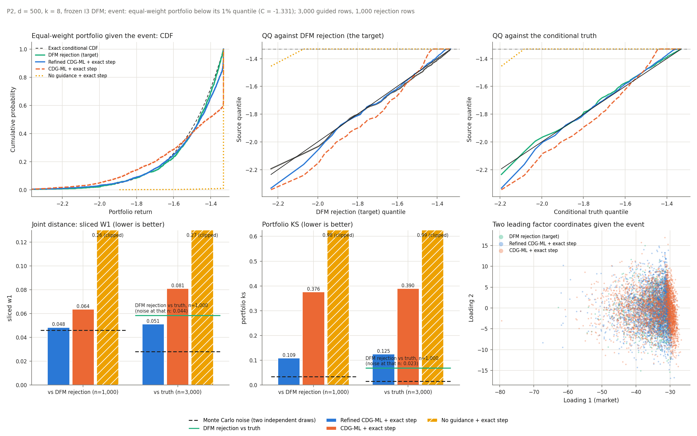

# 10. Guidage sur le DFM I3 à d = 500 (P2, k = 8)

**Question.** Une fois le DFM I3 entraîné, le guidage reproduit-il le rejet du DFM, qui
est sa cible ? On teste trois points :

- la recette Refined CDG-ML + dernier pas exact (Guo et al. (2026) pour H) ;
- l'apport des raffinements : CDG-ML + dernier pas exact ;
- le dernier pas exact seul, sans guidage.

**Réponse courte.**

- **Refined CDG-ML + dernier pas exact reproduit la loi jointe du rejet du DFM, au
  niveau du bruit,** aux deux seuils.
- **Sur le portefeuille, c'est au niveau du bruit à 5 %. À 1 %, il reste un surplus de
  lignes collées juste sous le seuil,** d'environ 11 points.
- **Les raffinements sont indispensables à 1 % :** sans eux, 37 % des lignes finissent
  exactement sur le seuil.
- **Sans guidage, le dernier pas exact ne sert à rien :** 95 à 99 % des lignes
  finissent sur le seuil.

## Cadre

- **Population P2** : facteurs gaussiens calibrés sur 500 actions du panel réel ; d = 500,
  k = 8.
- **DFM I3 figé** : le checkpoint DSM du rapport 9 (graine 42, N = 2 500, epoch 55).
- **Événements** : portefeuille équipondéré sous son quantile à 5 % (C = −0,941) ou à 1 %
  (C = −1,331).
- **H** : la recette du notebook (40k trajectoires, 50 epochs). Les deux H sont entraînés
  sur les mêmes trajectoires non guidées.
- **Tailles des échantillons** :
  - 3 000 lignes par source guidée ;
  - 1 000 lignes pour le rejet, en deux flux indépendants ;
  - 2 × 3 000 lignes pour la vérité.
- **Bruit Monte Carlo** : la distance entre deux tirages indépendants de la même loi, à la
  même taille d'échantillon.
- **CDG-ML avec un dernier pas d'Euler n'est ni échantillonné ni rapporté.**
- Code : [scripts/i3_conditional.py](../scripts/i3_conditional.py) (Modal) et
  [scripts/plot_i3_conditional.py](../scripts/plot_i3_conditional.py) (figures).

## Résultats

« Sur le seuil » compte les lignes posées exactement sur C. Le dernier pas exact les y
place quand la trajectoire arrive trop loin au-dessus du seuil. Elles ne comptent comme
violations de l'événement qu'à cause de l'arrondi float32.

### Événement à 5 %

| | Refined + pas exact | CDG-ML + pas exact | Sans guidage + pas exact | Bruit |
| --- | ---: | ---: | ---: | ---: |
| Sliced W1 vs rejet du DFM (n = 1 000) | **0,050** | 0,049 | 0,235 | 0,048 |
| KS du portefeuille vs rejet du DFM (n = 1 000) | **0,062** | 0,088 | 0,951 | 0,030 |
| Sliced W1 vs vérité (n = 3 000) | **0,041** | 0,042 | 0,237 | 0,028 |
| KS du portefeuille vs vérité (n = 3 000) | **0,018** | 0,098 | 0,947 | 0,016 |
| Lignes sur le seuil | 0,3 % | 6,0 % | 94,5 % | 0 % |
| Lignes à moins de 0,02 du seuil (vérité : 6,8 %) | 7,1 % | 14,7 % | 95,4 % | — |

### Événement à 1 %

| | Refined + pas exact | CDG-ML + pas exact | Sans guidage + pas exact | Bruit |
| --- | ---: | ---: | ---: | ---: |
| Sliced W1 vs rejet du DFM (n = 1 000) | **0,049** | 0,064 | 0,265 | 0,046 |
| KS du portefeuille vs rejet du DFM (n = 1 000) | **0,109** | 0,376 | 0,985 | 0,034 |
| Sliced W1 vs vérité (n = 3 000) | **0,051** | 0,081 | 0,267 | 0,028 |
| KS du portefeuille vs vérité (n = 3 000) | **0,125** | 0,390 | 0,988 | 0,016 |
| Lignes sur le seuil | 3,3 % | 36,8 % | 98,8 % | 0 % |
| Lignes à moins de 0,02 du seuil (vérité : 8,4 %) | 19,5 % | 43,2 % | 99,1 % | — |

**Le rejet du DFM face à la vérité** (n = 1 000) :

| Événement | Sliced W1 | Bruit (n = 1 000) | KS du portefeuille | Bruit (n = 1 000) |
| --- | ---: | ---: | ---: | ---: |
| 5 % | 0,054 | 0,044 | 0,037 | 0,023 |
| 1 % | 0,058 | 0,044 | 0,069 | 0,023 |

**Diagnostics de H en fin de trajectoire** (trajectoires de test) :

| | 5 % : Refined | 5 % : CDG-ML | 1 % : Refined | 1 % : CDG-ML |
| --- | ---: | ---: | ---: | ---: |
| Cosinus du gradient au dernier pas | 0,98 | 0,49 | 0,96 | 0,36 |
| RMSE de la probabilité au dernier pas | 0,027 | 0,112 | 0,032 | 0,071 |
| Perte de Brier sur le test (constante : 0,044 / 0,0079) | 0,0250 | 0,0252 | 0,0049 | 0,0052 |

### Figures

Chaque figure a six panneaux :

- en haut, la fonction de répartition du portefeuille sachant l'événement, puis deux
  graphes quantile-quantile, contre le rejet du DFM et contre la vérité ;
- en bas, les distances avec leurs niveaux de bruit, puis les deux premières coordonnées
  factorielles.

## Ce qu'on en déduit

1. **Le guidage reproduit sa cible sur la loi jointe.** Aux deux seuils, la distance
   sliced W1 entre Refined + pas exact et le rejet du DFM est au niveau du bruit (0,050
   contre 0,048 à 5 % ; 0,049 contre 0,046 à 1 %). Le résultat du rapport 7 (d = 128)
   tient donc à d = 500, sur un DFM I3.
2. **Sur le portefeuille à 1 %, il reste un surplus de lignes juste sous le seuil.**
   - 19,5 % des lignes sont à moins de 0,02 de C, contre 8,4 % pour la vérité ; 3,3 % sont
     exactement sur C.
   - Cause : en fin de trajectoire, une partie des chemins guidés est encore au-dessus du
     seuil. Le dernier pas exact les ramène dans l'événement, mais tout près de C, car le
     bruit de ce pas est minuscule (0,006 en unités de portefeuille).
   - D'où un KS de 0,11 à 0,12, alors que le reste de la loi est bon. À 5 %, ce surplus
     n'existe pas (7,1 % contre 6,8 %).
3. **Les raffinements comptent d'autant plus que l'événement est rare.**
   - **Loi jointe :** CDG-ML est aussi bon que Refined à 5 % (0,049), nettement moins bon
     à 1 % (0,064).
   - **Portefeuille :** 6 % de ses lignes sont sur le seuil à 5 %, et 37 % à 1 % (KS 0,38).
   - **Diagnostics :** son gradient au dernier pas est mauvais (cosinus 0,36 à 0,49 contre
     0,96 à 0,98), alors que sa perte de Brier globale est presque la même. Comme au
     rapport 2, c'est la fin de trajectoire qui fait la différence.
4. **Sans guidage, le dernier pas exact ne fait que tasser les lignes sur le seuil.**
   95 à 99 % des lignes y finissent. Le guidage est nécessaire ; le pas exact ne corrige
   que le dernier pas.
5. **Face à la vérité, l'écart joint restant est surtout celui du DFM.**
   - Le rejet du DFM est lui-même à 0,054–0,058 de la vérité, pour un bruit de 0,044 à sa
     taille d'échantillon.
   - Les tirages guidés sont à 0,041–0,051, pour un bruit de 0,028 à la leur.
6. **Coût.** Le coût fixe comprend la collecte des trajectoires, partagée par les deux H,
   et l'entraînement de H : 508 s à 5 %, 600 s à 1 %.
   - Ensuite, une ligne guidée coûte 8 à 11 ms. Une ligne de rejet coûte 105 ms à 5 % et
     720 ms à 1 %.
   - Le guidage devient rentable dès environ 5 300 lignes à 5 % et 850 lignes à 1 %.
   - L'entraînement de Refined est plus rapide que celui de CDG-ML : 115–138 s contre
     428–451 s.

## Limites

- **Une seule graine de DFM et une seule graine de H.**
- **P2 est gaussienne, et I3 y vaut à peu près la référence gaussienne I0** (rapport 9).
  Pour un modèle gaussien, la loi conditionnelle est une gaussienne tronquée connue en
  forme fermée. Ce test valide donc la mécanique de conditionnement à d = 500, pas le
  réalisme du générateur.
- **Le rejet ne compte que 1 000 lignes,** si bien que les distances au rejet ont un
  bruit plus élevé que les distances à la vérité.

## Suite possible

- **Renforcer le guidage en toute fin de trajectoire pour les événements rares :** plus de
  poids en fin de trajectoire, ou plus de trajectoires qui touchent l'événement pour
  entraîner H.
- **Partager la collecte des trajectoires entre plusieurs événements,** puisqu'elle ne
  dépend pas de l'événement.

## Fichiers

- [results/10_i3_guided_d500/](results/10_i3_guided_d500/) : tableaux complets
  (`summary_tail*.csv`), diagnostics de H et temps de calcul.
- Échantillons et checkpoints de H :
  - en local : `artifacts/i3_conditional/p2_i3_d500_k8_20261108T114439Z/` ;
  - sur le volume Modal `thesis-runs` : `/i3_conditional/`.
